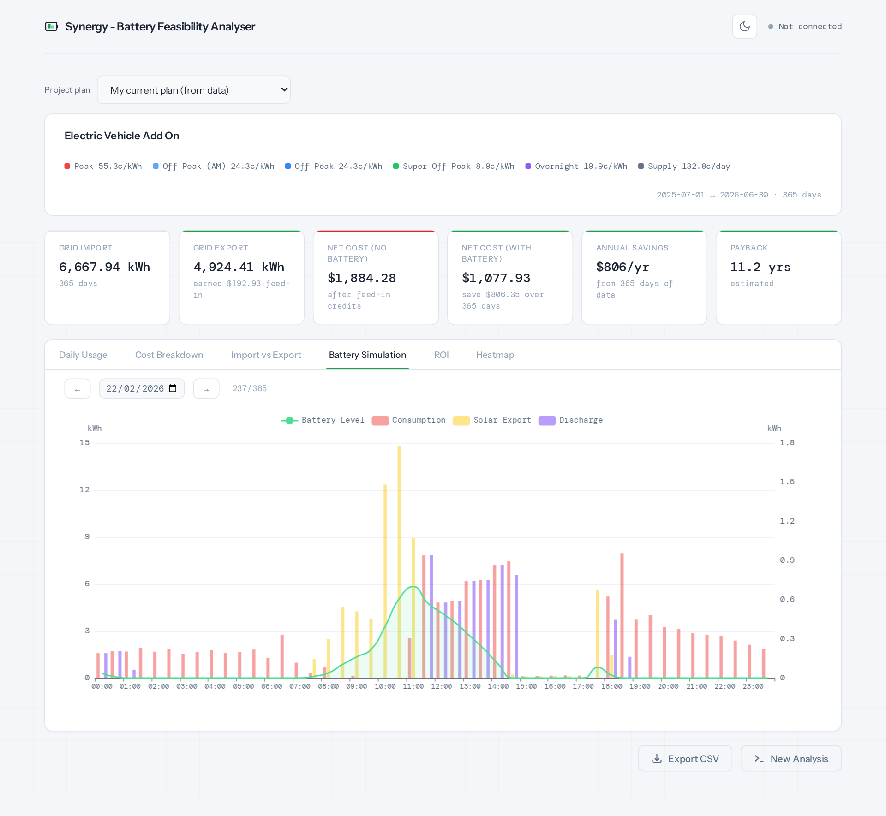

# Synergy Battery Feasibility Analyser

Work out whether a home battery is worth it, using your own half-hourly electricity data from [Synergy](https://www.synergy.net.au/) (Western Australia).

The app reads a year of your real usage and solar export, simulates a battery on it half-hour by half-hour, and shows what it would save, how long it would take to pay for itself, and which size suits your household.

> This project was built with AI assistance — thanks Claude! I had a personal need to review my energy usage and determine whether a home battery made financial sense. The speed at which I could go from idea to a working tool that analyses, visualises, and informs that decision was fantastic. Maybe someone else will find it useful too!

<p align="center">
  
</p>

## What it does

- **Reads your real data** from the My Synergy portal: every half-hour of grid import and solar export.
- **Compares up to three batteries** side by side (capacity and installed price): grid import and export, feed-in credits, usage and supply charges, net cost, annual saving, payback and 10-year return.
- **Recommends a size** by testing batteries from 0 to 30 kWh on your usage and finding where extra capacity stops paying its way.
- **Projects other plans**: see what your usage would cost on EV Add On, Midday Saver or Home Plan A1.
- **Uses current prices**, read from Synergy's published plan pages (editable).
- **Counts feed-in properly**: solar the battery stores is no longer exported, so its feed-in credit is lost, and that is taken off the saving.
- **Works offline** once your data is fetched, and remembers your settings between sessions.

## Getting started

There are two ways to run it. Both open the app in your web browser; nothing is installed into your browser.

### Option 1: download the app (easiest)

1. Download the file for your computer from the [Releases](https://github.com/sniereffo/synergy-battery-analyser/releases) page:
   - Windows: `synergy-battery-analyser-windows.exe`
   - Mac (Apple Silicon): `synergy-battery-analyser-macos.zip`. Open the zip and move **Synergy Battery Analyser** to your Applications folder.
   - Linux: `synergy-battery-analyser-linux`
2. Run it. The app opens in your browser. On Windows and Linux a small console window also opens. The Mac app runs quietly in the background, with no window or Dock icon.
3. To stop the app, click **Quit** at the top of the page. On Windows and Linux you can also close the console window. If you close the browser tab without quitting, open the app again to get back to it.

The first time you open it, your computer may warn you because the app isn't signed by a paid developer certificate:

- **Windows:** on the "Windows protected your PC" screen, click **More info**, then **Run anyway**.
- **Mac:** after the first attempt is blocked, open **System Settings → Privacy & Security** and click **Open Anyway**.
- **Linux:** make it executable (`chmod +x synergy-battery-analyser-linux`), then run it.

### Option 2: run it with uv

If you're comfortable with a terminal, [uv](https://docs.astral.sh/uv/getting-started/installation/) can run the latest version directly from GitHub, on Windows, Mac or Linux. Install uv once, then:

```bash
uvx --from git+https://github.com/sniereffo/synergy-battery-analyser synergy-analyser
```

uv downloads everything it needs, including the right version of Python. To keep it installed as a normal command instead:

```bash
uv tool install git+https://github.com/sniereffo/synergy-battery-analyser
synergy-analyser                 # run it
uv tool upgrade synergy-analyser # update later
```

Options: `--port 8080` to use a different port (by default it uses 8000, or the next free one), `--data-dir PATH` to choose where data is saved, and `--no-browser` to not open the browser automatically.

### About the Synergy login window

Synergy's login uses multi-factor authentication and a "are you human" check, so it can't be automated. When you click **Open Synergy login**, the app opens a separate browser window on Synergy's site. You log in as normal, including your one-time code, and the window closes by itself once you're in.

That login window is controlled by the app (so it can read your usage after you log in), which needs **Google Chrome** or **Microsoft Edge**. If you have either installed, it's used, with a fresh, empty profile (never your own profile, bookmarks or cookies). If you only use Firefox or Safari, the app downloads its own copy of Chromium the first time you log in. That happens once, takes a minute or two, and uses about 400 MB of disk space. The app itself still opens in your normal browser.

## Using it

1. **Data source.** Choose "Fetch live from Synergy", or a dataset you saved earlier (no login needed).
2. **Connect to Synergy** (live fetch only). Click **Open Synergy login**, log in, then pick your account.
3. **Analysis parameters.**
   - **Plan:** "My current plan" uses your actual tariff. Pick another plan to see what your usage would cost on it.
   - **Tariff rates:** filled in from Synergy's website. Check them against your bill.
   - **Date range:** defaults to the last 12 months. Use a full year if you can; see [Short date ranges](#short-date-ranges).
   - **Batteries to compare:** up to three, each with a capacity (kWh) and, optionally, the installed price.
   - **Inverter, efficiency, feed-in rates and grid top-up:** the defaults suit most systems.
4. Click **Fetch & Analyse**. A full year takes about a minute to fetch the first time. It's then saved, so re-running with different settings (or after reopening the app) is instant.

Your settings are remembered in your browser. **Reset to defaults** under the Analyse button clears them.

## Reading the results

- **Summary cards** describe the battery selected in **Show battery**: grid import and export, net cost without and with the battery, annual saving and payback.
- **Battery comparison** puts no battery and each of your batteries side by side. The bill is broken into **usage charges**, the **supply charge** and **feed-in credits**, adding up to **net cost**. The supply charge is a fixed daily fee you pay even if you buy no grid power, so it's the same in every column. Only feed-in credits offset it, and covering it entirely would mean exporting enough while buying almost nothing — rare in practice.
- **Recommendation:** the smallest size that captures 90% of the saving available up to 30 kWh, plus which of your batteries pays back fastest and which gives the best 10-year return.
- **Charts:**
  - **Daily Usage:** grid import per day, split by tariff period, with solar export.
  - **Cost Breakdown:** monthly cost by tariff period plus the supply charge and feed-in credits.
  - **Import vs Export:** daily grid import and export across the period.
  - **Battery Simulation:** any single day, half-hour by half-hour: battery level, usage, solar, discharge and grid top-up.
  - **Battery Size:** annual saving against battery capacity, with your batteries and the recommended size marked.
  - **ROI:** cumulative saving against the battery's price, showing where it pays back.
  - **Heatmap:** a calendar of daily usage.
- **Export CSV** downloads every half-hour of the analysis.

### Short date ranges

Savings and payback are always shown per year. With 12 months of data (360+ days) they're measured. With less, they're scaled up to a year in a straight line and labelled **projected**, and under 330 days a warning explains why: solar and household usage change a lot with the seasons, so a few winter months (or summer months) can be well off. Use a full year for a reliable figure.

## How the figures are calculated

The app has a **How these figures are calculated** section at the bottom of every page. In short:

- **Costs** use your plan's rates for every half-hour you bought from the grid, plus the daily supply charge, minus feed-in credits (DEBS: 10c/kWh 3pm–9pm, 2c/kWh otherwise, editable).
- **The battery** charges from excess solar (giving up that solar's feed-in credit) and discharges to cover what you'd otherwise buy, but only when grid power is worth more than the stored energy. It won't spend stored solar on cheap Super Off Peak power. Round-trip losses (90% by default) and the inverter's power limit apply.
- **Grid top-up** (optional) buys from the grid only in the cheapest period, after the solar expected later that day, and never on flat-rate plans.
- **Saving** = grid import avoided − feed-in lost − top-up cost. **Payback** = price ÷ annual saving. **10-year return** = annual saving × 10 − price.
- **Not included:** financing, price or tariff rises, battery degradation, replacement, maintenance or rebates (enter the price after any rebate), and any changes in how you'd use power with a battery.

These are estimates for personal planning based on your past usage. They're not financial advice or a quote. This tool isn't affiliated with Synergy. Get quotes and independent advice before buying.

## Privacy and your data

- **Your password** is typed into Synergy's own website, in the login window. The app never sees or stores it.
- **Your session** is held in memory only and ends when you close the app.
- **Your usage data** is saved only on your computer, in:
  - Windows: `%LOCALAPPDATA%\synergy-analyser\data`
  - Mac: `~/Library/Application Support/synergy-analyser/data`
  - Linux: `~/.local/share/synergy-analyser/data`
- **Network use:** the app only talks to Synergy (your data, and the public plan pages for prices). It runs on your computer at `http://127.0.0.1` and isn't reachable from other devices.
- **Your settings** are kept in your browser's local storage for this app.

## Troubleshooting

- **The login window doesn't open.** Check your internet connection (the first login may need to download a browser). Click **Open Synergy login** again. If it still fails, the message on screen says why.
- **"Your Synergy session has expired".** Log in again; your data and settings are kept.
- **A saved dataset is greyed out and marked "Old format".** It was saved by the version before Synergy changed its website in April 2026 and can't be read. Fetch the data again.
- **Fewer days than you asked for.** Synergy only keeps a limited amount of history, and nothing before you moved in. The results cover the days returned, and a note lists any missing dates.
- **Port already in use.** The app picks the next free port automatically and shows the address in its window.
- **The Mac app doesn't seem to open.** It has no window of its own. It opens your browser at `http://127.0.0.1:8000`. If it's already running, opening it again just brings the page back. Its log is in `~/Library/Application Support/synergy-analyser/app.log`.

## Development

Requires [uv](https://docs.astral.sh/uv/). The package is `synergy_analyser`; its source lives directly in `src/`.

```bash
git clone https://github.com/sniereffo/synergy-battery-analyser.git
cd synergy-battery-analyser
uv sync

# Run the app (saved data goes to the per-user folder; add --data-dir ./data to keep it in the repo)
uv run synergy-analyser

# Or run the server with auto-reload while editing (saved data goes to ./data)
uv run uvicorn synergy_analyser.main:app --host 127.0.0.1 --port 8000 --reload --reload-dir src

# Tests (offline) and checks
uv run pytest -q
uvx ruff check src --select F,E9
node --check src/static/app.js

# Live checks against Synergy (a login window opens; you log in)
uv run python scripts/smoke_fetch.py 2026-08-02
```

Environment variables: `SYNERGY_DATA_DIR` (saved data folder), `SYNERGY_BROWSER=chrome|msedge|chromium` (force the login browser), `SYNERGY_LOGIN_HEADLESS=1` (hide the login window; for automated checks only).

### Building the binaries

```bash
uv sync --group dev --no-editable --reinstall-package synergy-analyser
uv run --no-sync pyinstaller --noconfirm synergy-battery-analyser.spec   # -> dist/
```

The binary starts from `packaging/launcher.py` and bundles Playwright's driver, but no browser (see [About the Synergy login window](#about-the-synergy-login-window)). On macOS the spec builds `Synergy Battery Analyser.app` (no console, hidden from the Dock); elsewhere a single file with a console. Icons come from `packaging/icon/icon.svg`; `packaging/icon/build.sh` regenerates them. The [Release workflow](.github/workflows/release.yml) builds and smoke-tests Linux, Windows and macOS binaries. Run it manually for test builds, or push a `v*` tag to create a draft release.

## License

This project is licensed under the [Elastic License 2.0](LICENSE).
